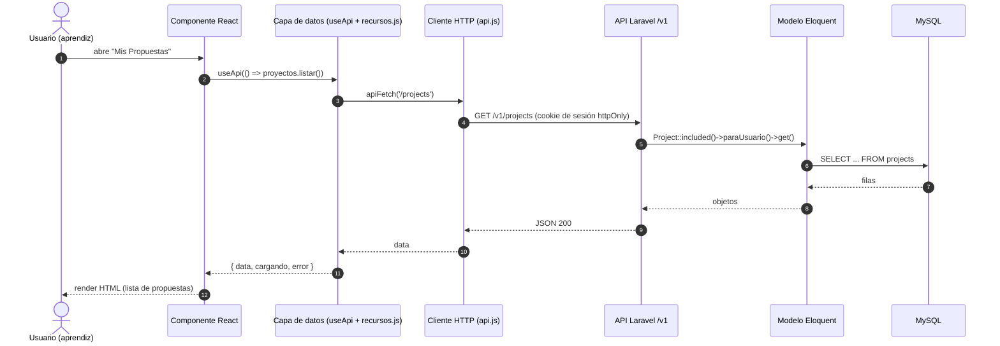
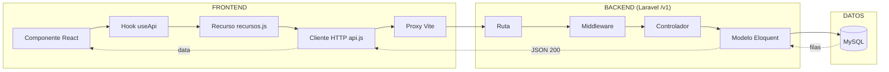

# ProyecTwin — Recorrido de una petición (GET)

Flujo representativo: **el aprendiz abre “Mis Propuestas”** → `GET /v1/projects`.

## 1. Diagrama de secuencia (recomendado)

## 2. Diagrama por capas (carriles)

## 3. Código de cada capa

| Capa | Archivo | Fragmento |
|---|---|---|
| Componente | `frontend/src/pages/aprendiz/Propuestas/Propuestas.jsx:81-85` | `useApi(() => proyectos.listar({ included: INCLUDE_PROYECTOS }), [], { inicial: [] })` |
| Hook | `frontend/src/lib/useApi.js:10` | `{ data, cargando, error, recargar }` |
| Recurso | `frontend/src/lib/recursos.js:116-120` | `apiFetch(`/projects${qs({ included: '...', ...filtros })}`).then(lista)` |
| Cliente HTTP | `frontend/src/lib/api.js:97` | `credentials: "include"` (cookie de sesión httpOnly; `apiFetch` :144, `apiDescargar` :278) · en escrituras `X-XSRF-TOKEN` leído de la cookie `XSRF-TOKEN` (:131) · `await fetch(url, { method, headers })` |
| Proxy | `frontend/vite.config.js:13` | `'/v1': { target: 'http://127.0.0.1:8000', changeOrigin: true }` |
| Ruta | `backend/routes/api-v1.php:130` | `Route::get('projects', [ProjectController::class, 'index'])` |
| Middleware | `backend/app/Http/Kernel.php:46-47` | `'cuenta.activa' => CuentaActiva::class` · `'rol' => RolMiddleware::class`; las rutas autenticadas incluyen además `CambioContrasenaObligatorio` (`routes/api-v1.php:57`) |
| Controlador | `backend/app/Http/Controllers/Api/ProjectController.php:24/35` | `Project::included()->paraUsuario($user)->get()` |
| Modelo | `backend/app/Models/Project.php:134` | `scopeParaUsuario(Builder $q, $user)` |
| Base de datos | — | `SELECT ... FROM projects` (MySQL) |

## Leyenda
- **Flechas continuas** → ida de la petición.
- **Flechas punteadas** → respuesta (vuelta).
- Colores (en la versión draw.io): frontend azul · backend verde · datos naranja.
